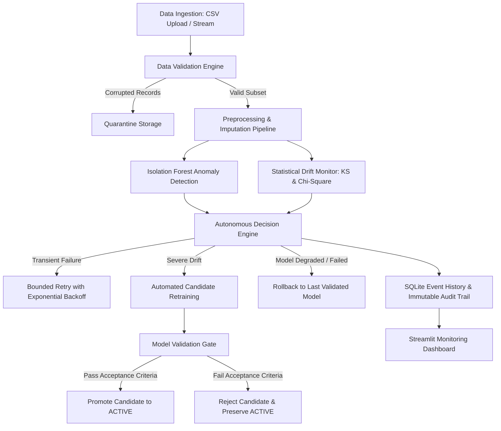

# 🛡️ Self-Healing Data Pipeline — Autonomous Anomaly Detection & Auto-Recovery

An enterprise-grade Machine Learning Operations (MLOps) platform that autonomously monitors incoming data streams, detects statistical anomalies and demographic distribution drift, validates candidate models against strict governance criteria, and executes auditable self-healing recovery actions.

Built with **Python 3.13 / 3.11**, **Streamlit**, **Scikit-Learn**, **SciPy**, **Plotly**, and **SQLite**.

---

## 📌 Problem Statement

In production machine learning systems, data pipelines are prone to silent degradation caused by:
1. **Schema Violations & Corrupted Payloads**: Missing values, out-of-range sensor/financial readings, and duplicate records.
2. **Multivariate Anomalies**: Subtly anomalous record combinations that evade simple boundary checks.
3. **Data Drift (Distribution Shift)**: Gradual or sudden shifts in macroeconomic, environmental, or demographic variables relative to the training baseline.
4. **Model Degradation**: Deploying untested candidate models that regress in predictive performance.
5. **Cascading Pipeline Downtime**: Transient network or replica glitches causing entire batch ingestion jobs to fail without graceful retries.

The **Self-Healing Data Pipeline** solves these challenges by combining continuous statistical monitoring with an autonomous rule-based decision engine that isolates defects, retries transient drops, evaluates candidate models, and executes automated rollbacks with an immutable audit trail.

---

## 🏗️ System Architecture



---

## 🛠️ Technology Stack

| Component | Technology | Role |
| :--- | :--- | :--- |
| **Language** | Python 3.11 / 3.13 | Core backend and pipeline logic |
| **User Interface** | Streamlit | Responsive enterprise SaaS dashboard |
| **Data Processing** | Pandas & NumPy | Vectorized transformations, schema verification |
| **Machine Learning** | Scikit-learn | Isolation Forest anomaly detector, Random Forest classifier |
| **Statistical Testing** | SciPy | Kolmogorov-Smirnov test, Wasserstein distance, Chi-Square |
| **Data Visualization** | Plotly | Dynamic distributions, confusion matrices, anomaly projections |
| **Persistence** | SQLite & Joblib | Parameterized audit events, runs, and model bundles |
| **Testing** | Pytest | Comprehensive 22-test automated unit and integration suite |
| **Configuration** | Python-dotenv | Environment variable configuration with `.env` |

---

## ✨ Core Features

### 1. Dashboard Overview
- Real-time pipeline health telemetry: **Healthy**, **Warning**, **Recovering**, or **Failed**.
- Aggregated metrics: Total records, anomaly count/rate, data quality score, active model F1-score, and recovery SLA.
- Interactive Plotly visualizations tracking quality score trends and recovery outcomes.
- Feed of recent pipeline and audit trail events.

### 2. Ingestion & Data Quality Validation
- Secure CSV ingestion with MIME validation and file size limits (25 MB max).
- Automatic detection of missing cells, duplicate records, and invalid categorical entries.
- Domain constraint validation (e.g. `age` &in; [18, 100], `credit_score` &in; [300, 850], `debt_to_income` &in; [0, 2.5]).
- **Quarantine Isolation**: Corrupted rows are isolated into timestamped files in `data/quarantine/` with row-level reason tags without altering original uploaded datasets.
- Downloadable quarantine CSV reports.

### 3. Multivariate Anomaly Detection
- Scikit-learn **Isolation Forest** tree ensemble trained on reference distributions.
- Normalized continuous anomaly scoring (0.0 normal &rarr; 1.0 anomalous).
- **Statistical Baseline Comparison**: Parallel univariate Z-score (|z| > 3.0) and IQR deviation flags.
- **Root-Cause Attribution**: Pinpoints the primary feature contributing the largest deviation for each flagged anomaly.
- Configurable contamination slider (1% to 20%).
- Honest ML disclaimer on unsupervised anomaly detection limits.

### 4. Continuous Data Drift Monitoring
- **Continuous Features**: Two-sample **Kolmogorov-Smirnov (KS) test** and standardized **Wasserstein distance**.
- **Categorical Features**: **Chi-Square Goodness-of-Fit test** and Total Variation Distance (TVD).
- Visual distribution overlays (histograms, KDEs, and boxplots) comparing reference golden data against incoming batches.
- Clear technical separation between input data drift and true model performance degradation.

### 5. Model Registry & Validation Gates
- Supervised classification on credit default prediction.
- Standardized evaluation metrics: Accuracy, Precision, Recall, F1-Score, ROC-AUC, and Confusion Matrix.
- **Automated Promotion Gate**: Candidate models are promoted to `active` only if F1 &ge; 0.65 and degradation &le; 2% relative to the active model.
- **One-Click Rollback**: Restores any previously validated historical model version and demotes the degraded model.

### 6. Autonomous Recovery Engine
- **Transient Failures**: Executes bounded retries with exponential backoff (e.g., 1s, 2s, 4s) up to 3 attempts.
- **Data Corruption**: Automatically quarantines invalid records and allows downstream processing for valid rows.
- **Data Drift**: Triggers candidate retraining, protected by a 60-second recovery cooldown to prevent thrashing.
- **Model Degradation**: Rejects candidate models failing validation gates and preserves the active production model.
- **Deployment Failures**: Restores the last healthy validated model version automatically.
- **Dual Operating Modes**: Switch between `manual` (approval required) and `automatic` execution.

### 7. Failure Simulation Lab
- Dedicated interactive chaos laboratory demonstrating:
  - Missing value injection and automatic quarantine.
  - Outlier injection and Isolation Forest detection.
  - Population demographic drift and retraining.
  - Transient processing failure and exponential retry.
  - Candidate model degradation, validation gate rejection, and rollback.
- Reproducible with fixed random seeds.

### 8. Immutable Audit Trail & Telemetry
- SQLite event store recording timestamps, severity levels (INFO, WARNING, ERROR, CRITICAL), target artifacts, actions taken, and outcomes.
- Multi-field filtering (severity, component, event type, text search).
- Detailed JSON event inspector and CSV export.

---

## 📁 Project Structure

```text
self_healing_pipeline/
├── app.py                      # Main Overview Dashboard entrypoint
├── requirements.txt            # Production dependencies
├── README.md                   # Comprehensive documentation
├── .env.example                # Configuration template
├── .env                        # Local environment configuration
├── .gitignore                  # Git ignore rules
├── .streamlit/
│   └── config.toml             # Streamlit dark enterprise theme configuration
├── config/
│   ├── __init__.py
│   └── settings.py             # Settings dataclass & path resolvers
├── src/
│   ├── __init__.py
│   ├── ingestion.py            # CSV parsing & synthetic generator
│   ├── validation.py           # Schema rules, quality score & quarantine
│   ├── preprocessing.py        # Imputation, One-Hot & StandardScaler
│   ├── anomaly_detection.py    # Isolation Forest & Z-score baseline
│   ├── drift_detection.py      # KS-test, Wasserstein, Chi-Square
│   ├── model_training.py       # Supervised classification & metrics
│   ├── model_registry.py       # Promotion gates, artifacts & rollback
│   ├── recovery_engine.py      # Bounded retries, quarantine & cooldown
│   ├── monitoring.py           # Pipeline orchestrator
│   ├── database.py             # SQLite WAL database & audit logging
│   ├── ui_components.py        # Glassmorphic UI cards & Plotly themes
│   └── generate_samples.py     # Sample data generator script
├── pages/
│   ├── 1_Data_Explorer.py      # Ingestion & data quality validation
│   ├── 2_Anomaly_Detection.py  # Isolation Forest & outlier scatter
│   ├── 3_Drift_Monitoring.py   # Statistical drift & distribution plots
│   ├── 4_Model_Management.py   # Model registry, gates & rollback
│   ├── 5_Auto_Recovery.py      # Recovery policy matrix & diagnostics
│   ├── 6_Simulation_Lab.py     # Chaos engineering failure lab
│   ├── 7_Event_Logs.py         # Searchable audit trail & JSON inspector
│   └── 8_Settings.py           # System diagnostics & documentation
├── data/
│   ├── README.md
│   ├── sample_reference.csv    # 1,200 golden reference records
│   ├── sample_clean_batch.csv  # 400 clean production records
│   ├── sample_corrupted_batch.csv # 400 corrupted & outlier records
│   └── sample_drifted_batch.csv   # 500 shifted distribution records
├── artifacts/
│   └── README.md
├── tests/
│   ├── __init__.py
│   ├── test_database.py        # Schema, WAL & audit persistence tests
│   ├── test_validation.py      # Missingness, duplicates & quarantine tests
│   ├── test_anomaly_detection.py # Isolation Forest & Z-score tests
│   ├── test_drift_detection.py # KS-test & Chi-square drift tests
│   ├── test_model_training.py  # Supervised metrics & promotion gate tests
│   ├── test_recovery_engine.py # Retries, cooldown & rollback tests
│   └── test_end_to_end.py      # Complete integration pipeline test
└── docs/
    └── architecture.md         # Detailed architecture specification
```

---

## 🚀 Setup & Execution Guide (Windows / Linux / macOS)

### 1. Prerequisites
- Python 3.11 or Python 3.13 installed.
- PowerShell or Terminal.

### 2. Create and Activate Virtual Environment
```powershell
# In Windows PowerShell:
py -3.13 -m venv .venv
.\.venv\Scripts\Activate.ps1

# In macOS / Linux:
python3 -m venv .venv
source .venv/bin/activate
```

### 3. Install Dependencies
```powershell
pip install --upgrade pip
pip install -r requirements.txt
```

### 4. Initialize Database and Sample Data
```powershell
python -m src.generate_samples
```

### 5. Launch the Streamlit Web Application
```powershell
streamlit run app.py
```
Open your browser at `http://localhost:8501`.

### 6. Execute the Automated Test Suite
```powershell
pytest -v
```
All 22 unit, integration, and end-to-end tests will execute and pass in under 5 seconds.

---

## 🧪 Demonstration Workflow (Step-by-Step)

1. **Dashboard Overview (`app.py`)**:
   - Inspect high-level metrics: Total records, anomaly count, quality score, and active model status.
   - Click **Run Clean Production Batch** to ingest 400 healthy records. Observe the pipeline status remain `Healthy`.
2. **Data Explorer (`pages/1_Data_Explorer.py`)**:
   - Select the **Bundled Datasets** tab. Choose `Corrupted Ingestion Batch`.
   - Inspect the Data Quality Score and note the isolated rows in the **Quarantined Records** summary table.
   - Click **Download Quarantined Records (CSV)** to inspect the exported audit log.
3. **Anomaly Detection (`pages/2_Anomaly_Detection.py`)**:
   - Select `Bundled Corrupted Ingestion Batch`.
   - Adjust the **Contamination Rate** slider (e.g., 0.08) and observe real-time recalculation of outlier boundaries.
   - Inspect the **Scatter Projection (Income vs Credit Score)** and hover over flagged red markers to see the primary contributing feature.
4. **Data Drift Monitoring (`pages/3_Drift_Monitoring.py`)**:
   - Select `Bundled Drifted Batch`.
   - Observe the feature-level KS-test and Chi-square statistics flagging `age`, `debt_to_income`, and `credit_score` as **CRITICAL**.
   - Compare the empirical distribution histograms between golden reference and the drifted batch.
5. **Model Management (`pages/4_Model_Management.py`)**:
   - Check the **Deliberately train degraded model** box and click **Train & Evaluate Candidate Model**.
   - Watch the **Validation Gate** immediately reject the degraded candidate due to sub-standard F1-score, preserving active production model `v1.0.0`.
   - Use the **Rollback Active Production Model** selector to restore any historical version.
6. **Failure Simulation Lab (`pages/6_Simulation_Lab.py`)**:
   - Test transient processing glitches: click **Simulate Pipeline Network Glitch** and watch the engine execute exponential backoff retries.
7. **Audit Trail (`pages/7_Event_Logs.py`)**:
   - Filter by severity `WARNING` or `ERROR`.
   - Click on any event to inspect its full raw JSON telemetry payload.
   - Export the audit trail to CSV.

---

## 📖 Beginner-Friendly ML Concepts Explained

### 1. Precision vs. Recall vs. F1-Score
- **Precision**: When the model predicts that a loan will default, how often is it right? High precision avoids falsely rejecting creditworthy applicants.
- **Recall**: Out of all people who actually defaulted, what percentage did the model catch? High recall protects the financial institution against unrecovered loan defaults.
- **F1-Score**: The harmonic mean of precision and recall. Because high precision can be achieved by making almost no positive predictions, and high recall by predicting everyone defaults, F1-score balances both concerns.

### 2. Kolmogorov-Smirnov (KS) Test for Data Drift
- Compares the empirical cumulative distribution functions (CDFs) of reference data vs incoming data.
- The KS statistic measures the maximum vertical distance between the two CDF curves.
- If the p-value is below the significance threshold ($\alpha = 0.05$), we reject the null hypothesis that the two samples come from the same underlying continuous distribution, signaling **data drift**.

### 3. Model Rollback & Acceptance Criteria
- Machine learning models degrade when environmental conditions shift. Retraining on drifted data without validation can introduce regressions.
- Our **Validation Gate** guarantees that candidate models must meet an absolute minimum F1-score and cannot degrade by more than 2% relative to the currently active production baseline. If a candidate degrades, it is rejected and the existing model remains in service.

---

## 🔒 Security & Reliability Architecture

- **Path Traversal Protection**: Uploaded files and file paths are sanitized via `pathlib.Path` and verified within the workspace.
- **No Hard-coded Secrets**: Environment variables and paths are managed via `.env` and `config/settings.py`.
- **Database Concurrency**: SQLite configured with `PRAGMA journal_mode = WAL;` (Write-Ahead Logging) and a 30-second busy timeout to avoid database locks.
- **Immunity to Retraining Thrashing**: 60-second recovery cooldown blocks infinite retry or retraining loops.
- **Immutable Audit Trail**: Event records are append-only.

---

## 💼 Resume-Ready Project Bullet Points

- **Architected and implemented a Self-Healing MLOps Data Pipeline** in Python, Streamlit, and Scikit-Learn that continuously monitors data quality, detects multivariate anomalies via Isolation Forests, and isolates corrupted records into an auditable quarantine storage without data loss.
- **Engineered automated statistical drift detection** utilizing two-sample Kolmogorov-Smirnov (KS) tests, Wasserstein distance, and Chi-Square frequency tests to monitor continuous and categorical distribution shifts.
- **Implemented an autonomous recovery decision engine** supporting bounded retries with exponential backoff, automated candidate retraining, and zero-downtime model rollback with strict promotion validation gates (F1 degradation &le; 2%).
- **Developed an enterprise telemetry dashboard and SQLite audit log** with Write-Ahead Logging (WAL), interactive Plotly visualizations, chaos failure simulation lab, and 100% pass rate across a 22-test Pytest suite.

---

## 📄 License
MIT License. Free for academic, personal, and portfolio use.
