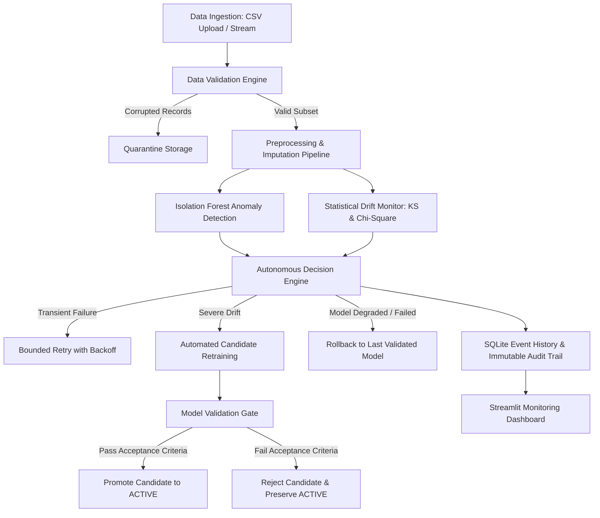

# Self-Healing Data Pipeline Architecture Specification

## 1. System Overview

The **Self-Healing Data Pipeline** is an enterprise-inspired Machine Learning Operations (MLOps) platform designed to autonomously monitor incoming data streams, detect statistical distribution anomalies, identify demographic drift, validate candidate models against governance criteria, and trigger auditable, self-healing recovery actions.

---

## 2. Component Specifications

### 2.1 Ingestion & Validation Engine (`src/ingestion.py`, `src/validation.py`)
- **File Validation**: Inspects MIME type, file size bounds (default &le; 25MB), empty files, and encoding fallbacks (UTF-8, Latin-1).
- **Domain Constraints**: Enforces type and range validations on key features (e.g. `age` &in; [18, 100], `credit_score` &in; [300, 850], `debt_to_income` &in; [0, 2.5]).
- **Quality Score**: Computes a holistic quality score (0–100%) incorporating missingness, duplicate rows, and out-of-range rates.
- **Quarantine Isolation**: Severe errors are partitioned and exported to `data/quarantine/` with row-level reason annotations without altering the original input file.

### 2.2 Preprocessing Pipeline (`src/preprocessing.py`)
- Median imputation for missing numeric variables.
- Most-frequent imputation and One-Hot Encoding for categorical features.
- StandardScaler normalization across all continuous features.
- Serialized alongside trained models to guarantee feature parity between training and inference.

### 2.3 Anomaly Detection (`src/anomaly_detection.py`)
- **Algorithm**: Scikit-Learn `IsolationForest` (unsupervised ensemble of isolation trees).
- **Continuous Scoring**: Normalized anomaly scores between 0.0 (normal) and 1.0 (highly anomalous).
- **Statistical Baseline**: Computes univariate Z-scores (|z| > 3.0) and IQR bounds for cross-validation against simple heuristics.
- **Root-Cause Attribution**: Identifies the primary feature contributing the maximum deviation from the reference mean for each flagged record.
- **ML Governance**: Explicit disclaimer emphasizing that unsupervised anomalies are statistical outliers, not confirmed defects or fraud.

### 2.4 Data Drift Monitoring (`src/drift_detection.py`)
- **Continuous Features**: Two-sample Kolmogorov-Smirnov test (`scipy.stats.ks_2samp`) and standardized Wasserstein distance.
- **Categorical Features**: Chi-Square Goodness-of-Fit test (`scipy.stats.chisquare`) and Total Variation Distance (TVD).
- **Drift Thresholds**:
  - Warning: p-value < 0.05 or Wasserstein > 0.15
  - Critical: p-value < 0.01 or Wasserstein > 0.25
- **Separation of Concerns**: Explicitly differentiates feature drift (input distribution shift) from model degradation (which requires ground truth labels).

### 2.5 Model Training & Registry (`src/model_training.py`, `src/model_registry.py`)
- Supervised classification (RandomForest / GradientBoosting) on credit risk data.
- Metrics: Accuracy, Precision (weighted), Recall (weighted), F1-Score (weighted), ROC-AUC, and Confusion Matrix.
- **Validation Promotion Gate**:
  - Candidate F1-Score must be &ge; `MODEL_MIN_F1_SCORE` (default 0.65).
  - Candidate F1-Score must not degrade by more than `MODEL_DEGRADATION_TOLERANCE` (default 2%) relative to the currently active model.
  - If criteria are met: promoted to `active`, previous active demoted to `archived`.
  - If criteria fail: candidate marked as `rejected`, active model preserved, audit log recorded.
- **Rollback Mechanism**: Restores any previously validated historical version from disk and sets it to `active`.

### 2.6 Autonomous Recovery Engine (`src/recovery_engine.py`)
- **Bounded Retry**: Exponential backoff ($t = \text{base} \times 2^{\text{attempt}-1}$) up to `MAX_RETRY_ATTEMPTS` (default 3).
- **Quarantine Policy**: Isolates invalid records; continues processing the valid subset.
- **Cooldown Protection**: 60-second recovery cooldown blocks rapid repeated retraining loops or thrashing.
- **Dual Operating Modes**:
  - `manual`: Presents decisions as recommendations requiring user confirmation.
  - `automatic`: Executes safe, predefined recovery rules autonomously.

### 2.7 SQLite Persistence & Audit Trail (`src/database.py`)
- Configured with Write-Ahead Logging (WAL) and foreign keys enabled.
- Tables: `pipeline_runs`, `anomaly_events`, `drift_events`, `model_registry`, `recovery_actions`, `system_events`.
- Immutable audit log style: every decision, failure, and recovery is recorded with UTC timestamp and component identifier.
